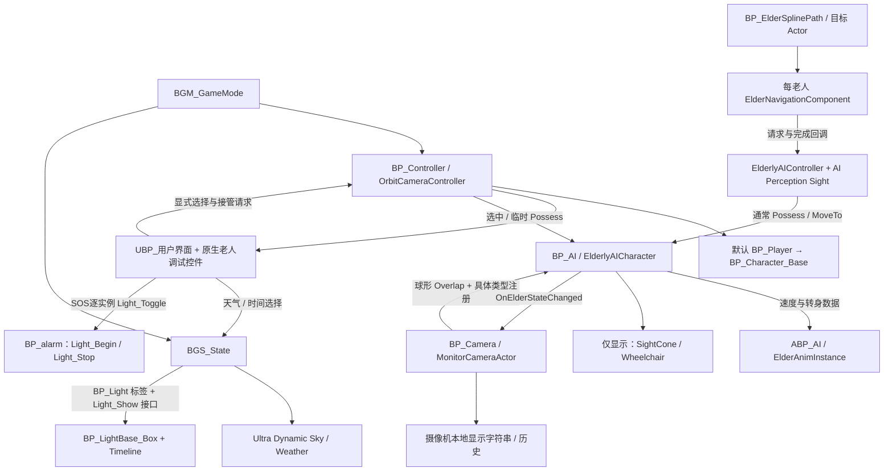
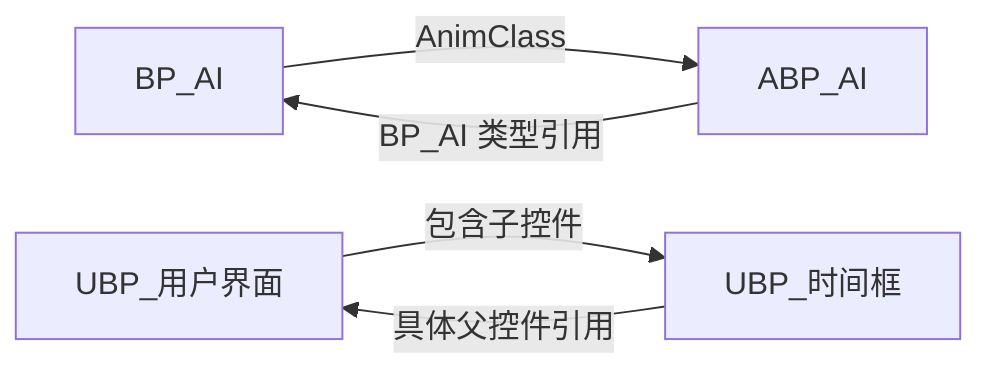

# 项目架构

审计基准：2026-09-03。以下为已检查的现状，非最初需求的完成声明。范围与证据见 [审计报告](docs/PROJECT_AUDIT_REPORT.md)。

## 架构选择

单个运行时模块 `Old_Man_Jiang` 提供老人、控制器、导航、动画支持、监控和 UI 基类；Blueprint 保留组件配置、资源、场景搭建和已有 UI/天气灯光图。没有理由为文档工作统一迁移到纯 C++ 或重新分模块。

## 状态与边界

- 老人实例拥有姓名/性别/状态；Controller 拥有选中与接管对象；路线组件拥有路线进度。
- AIController 拥有实际感知配置与寻路请求。角色上的 Sight 参数是初始化来源，不是已完成的运行时自动同步机制。
- `BGS_State` 拥有天气/时段选择，UDS 负责天空表现，单灯拥有目标开关及渐变进度。
- 监控本地历史是派生记录，不是老人状态权威；UI、AnimInstance 的展示数据也不是权威副本。
- 当前没有查到项目自有 GameInstance/SaveGame 体系；不能把 GameState、字符串历史当作持久存储。

## 已确认的包级环

包依赖环不等于执行递归或必然内存泄漏。本次只登记，后续有相关需求时再评估移除反向具体类型引用；不自动重设父类。

目标演进和确认门槛见 [ROADMAP](docs/ROADMAP.md)，状态所有权表见 [DATA_FLOW](docs/DATA_FLOW.md)。
